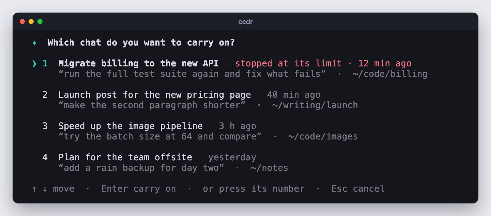

# ccd

## Install

```
curl -fsSL https://raw.githubusercontent.com/udayanwalvekar/ccd/main/ccd.sh | bash
```

## What it does

ccd does three main things:

1. **It always starts Claude Code in dangerously mode.** No permission prompts. Claude doesn't stop to ask you before it runs a command or changes a file.
2. **You can add all your Claude subscriptions.** You never have to worry about swapping tokens by hand again. ccd starts every chat on the account with the most usage left.
3. **When one account runs out, ccd moves your chat to another one by itself.** You don't start a new chat. Claude still has the whole conversation, in the same window.

It also gives you a bunch of customisations, listed below.

| Type | What it does |
|---|---|
| `ccd` | Starts a chat on the account with the most usage left. |
| `ccdm` | Shows all your accounts and how much is left on each. You pick one. |
| `ccdr` | Shows your recent chats. You pick a chat, then an account, and it carries on there. |
| `ccd 200` | Only uses your $200 accounts. `ccd 100` only uses your $100 ones. Works with `ccdm` and `ccdr` too. |
| `ccd accounts` | Shows how much is left on every account. |
| `ccd add` | Adds another account. |
| `ccd remove <name>` | Forgets an account. |
| `ccd update` | Gets the newest ccd. Your accounts stay. |
| `ccd uninstall` | Removes ccd and the accounts you added. |
| `CCD_AUTO=0 ccd` | Starts a chat that won't move by itself. |

Anything else you type goes straight to Claude Code, like `ccd --model opus` (except `--help` and `--version`, which ccd answers itself). A chat started that way won't move by itself.

Want the permission prompts back? Open `~/.config/ccd/config.json` and add this line next to what's already there. Don't replace the file: your accounts are in it.

```json
"claude_args": []
```

## Codex too: cx

`cx` is ccd for Codex, and works the same way. It always starts Codex in yolo mode (`--dangerously-bypass-approvals-and-sandbox`) on whichever of your Codex accounts has the most usage left, and when a chat hits its limit, it moves it to another account by itself.

| Type | What it does |
|---|---|
| `cx` | Starts Codex on the account with the most usage left. |
| `cxm` | Shows your Codex accounts and how much is left on each. You pick one. |
| `cxr` | Shows your recent Codex chats. You pick a chat, then an account, and it carries on there. |
| `cx 200` | Only uses your $200 accounts. `cx 100` only your $100 ones. Works with `cxm` and `cxr` too. |
| `cx accounts` | Shows how much is left on every Codex account. |
| `cx add` | Adds another Codex account. You sign in to it in your browser. |
| `cx remove <name>` | Forgets an account. Its folder and chats stay. |
| `CCD_AUTO=0 cx` | Starts a chat that won't move by itself. |

Codex keeps each login in a folder of its own, so every account you add gets one: `~/.codex-<name>`. It links `config.toml`, `AGENTS.md`, `rules`, `skills` and your chats (`sessions`) to your usual `~/.codex`, so every account works the same, and every chat is in one place, like Claude's: plain `codex resume` finds it whichever account it ran on. Already have a signed-in `~/.codex-<name>` folder? `cx add <name>` uses it, and moves its chats into `~/.codex/sessions` (a chat that is in both keeps its newer copy; the older one goes to `~/.codex/sessions-older-copies`).

ccd never reads a Codex token: it asks Codex itself (`codex app-server`) how much is left. A move reopens the same chat on the new account, and Codex sends the carry-on note by itself. The move works like ccd's: it waits 20 seconds, waits for a command that's still working, and checks again every 5 minutes if no account has room.

Want Codex's own approvals back? Add `"codex_args": []` to `~/.config/ccd/config.json`. Your own `--sandbox`, `--ask-for-approval` or `--approve-for-me` also replaces the default for that chat.

## Setup

You can also ask Claude Code to install it for you:

> Install ccd for me by running `curl -fsSL https://raw.githubusercontent.com/udayanwalvekar/ccd/main/ccd.sh | bash`, then tell me how to add my other Claude accounts.

You need a Mac, [Claude Code](https://claude.com/claude-code) and Python 3.9 or newer.

ccd already knows the account you use in Claude Code. To add your other accounts, run `ccd add` once for each one and sign in with it in your browser.

## Why I made this

It started as a simple alias. I always run Claude Code with `--dangerously-skip-permissions`, so `ccd` was just short for that: **C**laude **C**ode, **d**angerously.

Then I needed more usage, so I added more Claude accounts. Every switch meant taking one token out of my `~/.zshrc` and putting the next one in, again and again. So I made ccd do it for me: it checks every account and starts the chat on the one with the most usage left.

Then came the next problem. A long chat would run out on its account, and I had two bad options: wait for that account to reset, or ask another Claude to read the old chat and start over. So I automated that too. Now when a chat hits its limit, ccd reopens the same chat on another account, in the same window, with nothing summarised.

Some tasks are really long and need the usage of a $200 plan, not a $100 one. So `ccd 200` only uses my $200 accounts.

And sometimes I just want to pick the account myself. So I added `ccdm` (m = manual).


For the rare time I want to move a chat by hand, there's `ccdr` (r = resume): pick the chat, then the account.



## How the move works

- ccd waits 20 seconds first, so you can read the limit message.
- If the chat has a command still working, like a build, it waits until that's done. Something that just sits there, like a preview server, isn't waited for: it stops with the move, and Claude is told to restart it.
- If no account has room, the chat stays as it is, and ccd checks again every 5 minutes.
- Every automatic move is written to `~/.config/ccd/moves.log`.

Use ccd only with your own Claude accounts. Sharing a login with someone else is against Anthropic's [terms](https://www.anthropic.com/legal/consumer-terms).
