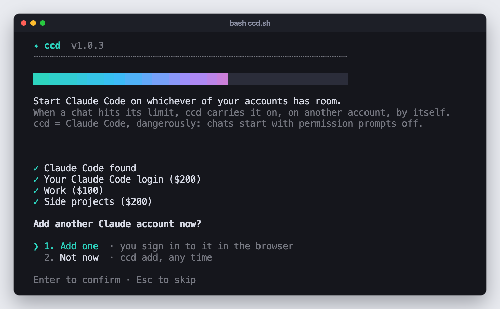
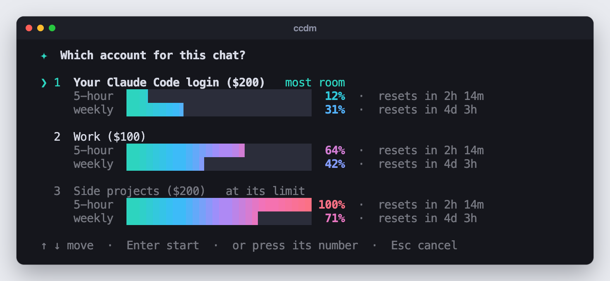

# ccd

ccd is a command-line tool that starts Claude Code on whichever of your Claude accounts has the most usage left. When a chat hits its limit, ccd reopens it on another of your accounts in the same terminal window, with nothing summarised.

Permission prompts are off in every chat it starts. Claude can run commands and edit files without asking.

## Install

```
curl -fsSL https://raw.githubusercontent.com/udayanwalvekar/ccd/main/ccd.sh | bash
```

You can also download [`ccd.sh`](ccd.sh) and run `bash ccd.sh`, or ask Claude Code to do it for you:

> Install ccd for me by running `curl -fsSL https://raw.githubusercontent.com/udayanwalvekar/ccd/main/ccd.sh | bash`, then tell me how to add my other Claude accounts.

Mac only for now. You'll need [Claude Code](https://claude.com/claude-code) and Python 3.9 or newer. Python comes with Apple's Command Line Tools: `xcode-select --install`.

The installer puts the program in `~/.local/share/ccd` and `ccd`, `ccdm` and `ccdr` in a folder already on your PATH. If no suitable folder is on your PATH, it adds one line to `~/.zshrc` (`~/.bash_profile` if you use bash) that puts `~/.local/bin` on it. It changes nothing else. A short welcome then offers to add your other accounts.



## Why I made this

It started as a simple alias. I always run Claude Code with `--dangerously-skip-permissions`, so `ccd` was just short for that: **C**laude **C**ode, **d**angerously.

Then I needed more usage, so I added more Claude accounts. Every switch meant taking one token out of my `~/.zshrc` and putting the next one in, again and again. So I made ccd do the routing: it checks every account and starts the chat on the one with the most room left.

Then came the next problem. A long chat would run out on its account, and I had two bad options: wait for that account to reset, or ask another Claude to read the old chat and start over. So I automated that too. Now when a chat hits its limit, ccd reopens it on another account by itself.

Some tasks are really long and need the usage of a $200 plan, not a $100 one. So `ccd 200` only uses my $200 accounts.

And sometimes I just want to pick the account myself. So I added `ccdm` (m = manual).



For the rare time I want to move a chat by hand, there's `ccdr` (r = resume): pick the chat, then the account.


## Commands

| Type | What happens |
|---|---|
| `ccd` | Starts a chat on the account with the most room left. |
| `ccdm` | Lists your accounts with their 5-hour and weekly limits. You pick one, then the chat starts. |
| `ccdr` | Lists recent chats, with those stopped at a limit on top. Pick a chat, then an account, to reopen it there. |
| `ccd accounts` | Shows every account and how much is left. |
| `ccd add` | Adds another of your accounts. |
| `ccd remove <name>` | Forgets an account. |
| `ccd 200` / `ccd 100` | Only uses accounts on the chosen monthly plan: $200 or $100. Works with `ccdm` and `ccdr` too. |
| `ccd update` | Gets the newest ccd. Your accounts stay. |
| `ccd uninstall` | Removes ccd, its settings and the tokens it kept. |

Any other words go to `claude` as they are, for example `ccd --model opus`.

## Adding an account

ccd finds your usual Claude Code login without setup. For each other account, run `ccd add`. It runs `claude setup-token`, which opens a sign-in page in your browser. Sign in with the account you want to add. If the page shows a different account, sign out of claude.ai first, or open the printed link in a private window. ccd reads the token from the screen, checks it, asks for the account's name and plan, and keeps it.

For an existing token, choose "Paste a token I already have", or pipe it in: `ccd add Work 200 < token.txt`.

## How the automatic move works

ccd stays running behind each chat it starts. When the chat stops at a usage limit and another account has room, ccd closes the chat and reopens it with `claude --resume` on that account, in the same window. The reopened chat gets a first message saying which account it moved from and to, and asking it to carry on.

- It waits 20 seconds first, so you can read the limit message.
- It waits for busy background commands, such as a build or render, but not idle ones, such as a preview server.
- It skips accounts with under 5% left, and keeps away for an hour from an account the chat just stopped on.
- If no account has room, the chat stays as it is. ccd checks again every 5 minutes.
- Running background commands and helper agents end with the move. The reopened chat is told so, and restarts what is still needed.
- `CCD_AUTO=0 ccd` switches the automatic move off for one chat. Chats started with extra words for claude, such as `ccd --model x`, are never moved.
- Every move is written to `~/.config/ccd/moves.log`.

## Turning permission prompts back on

By default every chat starts with `claude --dangerously-skip-permissions`, so a chat that ccd moves by itself never sits waiting on a question nobody is there to answer. To get Claude Code's own prompts back for `ccd`, `ccdm`, `ccdr` and automatic moves, put this in `~/.config/ccd/config.json`:

```json
{ "claude_args": [] }
```

## Your own accounts only

ccd is for switching between Claude accounts **you** own. Anthropic's [Consumer Terms](https://www.anthropic.com/legal/consumer-terms) don't allow sharing your login with anyone else. Their [Claude Code docs](https://code.claude.com/docs/en/legal-and-compliance) say subscription logins are meant for ordinary use of Claude Code. To read an account's limits, ccd sends a 1-token request with that account's token. Anthropic can change how limits and logins work at any time. Use ccd at your own risk.

## Privacy

- Tokens stay in the macOS Keychain under service `ccd`. A token goes only into the environment of its chat and that chat's commands. ccd never prints it, but `claude setup-token` shows it on screen once when you add an account, as it always does.
- ccd reads your Claude Code login from the Keychain without changing or refreshing it. If it expires after going unused, ccd can't check its limits and shows "not checked". Starting a chat on it lets Claude Code renew it.
- ccd talks only to `api.anthropic.com`, plus GitHub when you run `ccd update`.

## Good to know

- The first message after a move re-reads the whole chat once on the new account. On a very long chat, that takes a visible bite out of the new account's 5-hour limit.
- If you started a chat with extra words (a model, say) and later reopen it with `ccdr`, those words aren't carried over. It opens with your defaults.
- Work that barely uses the processor, such as a download or slow remote job, can look idle and get cut off by a move.
- Chats opened before you installed ccd, or started with plain `claude`, aren't watched. Use `ccdr` for those.

## License

MIT
